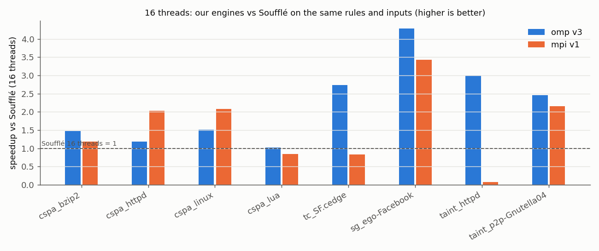

# Parallel Datalog engine for program analysis (taint, points-to) vs Soufflé

Course project, Parallel Programming. A static taint analysis is a **fixpoint** over Datalog rules;
on real programs the expensive part is the points-to / alias analysis underneath it. We built a small
engine of **6 parallel relational operators** (join, flip, filter, dedup, minus, merge) plus a
semi-naive fixpoint driver, wrote four standard rule sets with it, and implemented the operators three
times: **OpenMP** (Person A), **MPI** (Person B), **CUDA via Thrust** (Person C). Everything is
compared against **Soufflé 2.5**, the standard Datalog engine for static analysis, on the same rules
and inputs, and every result is checked against Soufflé's.

## Summary (17 Nov 2026)

- **Soufflé does not scale well, and the profile shows why.** From 1 to 16 threads it gets only
  2.3–4.7× (TC SF.cedge, CSPA httpd, CSPA linux). Its join parallelizes (6–8×), but merging the new
  facts into the full relation is a **serial loop**: 35–79 % of its 16-thread time (§4). This
  matches the GPUlog authors' 77.8 % for Soufflé on TC.
- **The obvious parallelization is not enough.** Our first OpenMP version (parallel join, sort and
  merge) is slower than Soufflé on TC (28.7 s vs 17.2 s), because it still rebuilds the full
  relation every round (287 rounds).
- **Attacking the merge works.** At 16 threads our best version beats Soufflé at 16 threads on every
  input with real work: CSPA (points-to on real C programs) 1.6× bzip2, 2.0× httpd, 2.1× linux,
  TC 2.7×, SG 4.6×, taint 2.5×, and Lua 1.04× (a tie). Against Soufflé's serial code that is
  4.9–50× (§6).
  - OpenMP v3 (lazy merge) wins on TC and taint.
  - MPI (every rank merges only 1/16 of each relation) wins on CSPA httpd and linux, even on one machine.
- **Verdict: worth doing and not trivial** (§7). Each person has a real bottleneck left:
  - Person A: memory of the hash sets, 14 GB on httpd.
  - Person B: communication, 6.5 of 20 s on TC.
  - Person C: the GPU run, not done yet.
- Not done (cut for time): SG profile, PostgreSQL, the CUDA run on a GPU, OpenMP v3 at 1 thread.
  `scripts/resume.sh` and [scripts/colab.md](scripts/colab.md) continue from here.

## Contents
1. [What is where](#1-what-is-where)
2. [Build, test, run](#2-build-test-run)
3. [Rule sets and inputs](#3-rule-sets-and-inputs)
4. [Profile of Soufflé](#4-profile-of-soufflé)
5. [Our engine and the three methods](#5-our-engine-and-the-three-methods)
6. [Benchmarks: 1 and 16 threads](#6-benchmarks-1-and-16-threads)
7. [Is it worth it? Verdict and next steps](#7-is-it-worth-it-verdict-and-next-steps)
8. [Decisions made while running unattended](#8-decisions-made-while-running-unattended)

---

## 1. What is where

| Part | Who | Files |
|---|---|---|
| Rule sets as Soufflé programs (baseline + correctness oracle) | group | [rules/](rules/) (`cspa.dl`, `sg.dl` copied from GPUlog's benchmark) |
| Engine: relation type, I/O, the rule sets written as operator calls, `main` | group | [engine/](engine/): `programs.h` (rules), `host_backend.h` (sequential operators) |
| **OpenMP operators** | **Person A** | [omp/omp_backend.h](omp/omp_backend.h) |
| **MPI operators** | **Person B** | [mpi/mpi_backend.h](mpi/mpi_backend.h) |
| **CUDA / Thrust operators** | **Person C** | [cuda/thrust_backend.h](cuda/thrust_backend.h) (+ [scripts/colab.md](scripts/colab.md)) |
| Data download, converters, existing extractor (SVF) wrapper | group | [tools/](tools/) |
| Tests, profile, benchmarks, plots | group | [tests/](tests/), [scripts/](scripts/), [results/](results/) |

Optimized code is marked with `OPT` comments: `grep -rn OPT omp mpi cuda engine`.

## 2. Build, test, run

WSL Ubuntu 24.04: `apt install build-essential libopenmpi-dev openmpi-bin python3-matplotlib clang-18
llvm-18 linux-tools-generic docker.io` + Soufflé 2.5 (`x86_64-ubuntu-2404-souffle-2.5-Linux.deb` from the
Soufflé GitHub releases) + `nvidia-cuda-toolkit` only for the GPU build.

```bash
make                              # Soufflé baselines (bin/souffle_*) + bin/seq omp mpi thrust_omp relhash
make test                         # every engine/version/thread count == Soufflé on the test cases
bash tools/download_data.sh       # real-program CSPA facts (httpd, linux, postgresql) + benchmark graphs
bash tools/svf_programs.sh        # bzip2, Lua, SQLite through SVF (Docker) -> facts
bash scripts/run_all.sh           # Soufflé profile + all benchmarks (~2 h)
python3 scripts/plot.py           # results/summary.md + charts

bin/omp -v 3 -t 16 -r cspa -F ~/stadata/inputs/cspa_linux        # one run (prints one CSV line)
mpirun -np 16 bin/mpi -r cspa -F ~/stadata/inputs/cspa_linux
```

Every engine prints `engine,version,threads,rules,input,load_s,solve_s,iters,join_s,sort_s,diff_s,
comm_s,rss_MB,Rel=size:hash|...`. The hash is order-independent, so two engines agree iff the
strings are equal; `bin/relhash` computes the same string from Soufflé's CSV output.

## 3. Rule sets and inputs

A **fact** is a row of a table (e.g. `assign(7, 3)`: "the value of 3 flows into 7"); a **rule** derives
new rows from existing ones; the engine applies the rules until nothing new appears (the fixpoint).
The rules are written once per analysis; only the facts change from program to program.

| Rule set | Rules | Recursive relations | Why it is in the set |
|---|---|---|---|
| **taint** ([rules/taint.dl](rules/taint.dl)) | 3 | Reach | the application: attacker data from a source reaching a sink |
| **TC** transitive closure ([rules/tc.dl](rules/tc.dl)) | 2 | path | classic benchmark, huge output |
| **SG** same generation ([rules/sg.dl](rules/sg.dl)) | 2 | sg | join on both sides of the recursive relation |
| **CSPA** points-to ([rules/cspa.dl](rules/cspa.dl)) | 10 | ValueFlow, MemoryAlias, ValueAlias | what taint needs on real C code: 3 mutually recursive relations, non-linear join (VF ⋈ VF) |

Inputs (all from existing tools or public datasets, no own C parser):

| Input | Source | Size |
|---|---|---|
| `cspa_httpd`, `cspa_linux`, `cspa_postgresql` | Graspan's points-to facts of **httpd 2.2.18, Linux 4.4-rc5, PostgreSQL 8.3.9** (the inputs of the GPUlog paper), from harp-lab/gdlog-HIP | 1.5M / 9.5M / 4.7M input facts |
| `cspa_bzip2`, `cspa_lua`, `cspa_sqlite` | **bzip2 1.0.8, Lua 5.4.7, SQLite 3.54** compiled with clang-18 to LLVM bitcode, pointer graph from **SVF** (`wpa -ander -print-pag`, Docker image `svftools/svf`), converted by [tools/svf_to_facts.py](tools/svf_to_facts.py) | 21k / 60k / 300k input facts |
| `tc_*`, `sg_*` | the TC / SG graphs of the GPUlog paper (SuiteSparse / SNAP: p2p-Gnutella04, SF.cedge, fe_body, ego-Facebook, CA-HepTh) | 40k – 220k edges, results 15M – 156M facts |
| `taint_*` | `Flow` = a flow graph, sources / sinks / sanitizers chosen at random (fixed seed), as in the plan doc §4: real program value flow (`taint_httpd`: the ValueFlow computed by CSPA on httpd) and large graphs with 8192 sources (`taint_p2p-Gnutella04`, `taint_fe_body`) | |

Checks that the data and rules are right: Soufflé's CSPA output on httpd is exactly the GPUlog paper's
(ValueAlias 234,237,608, MemoryAlias 88,905,342, ValueFlow 1,365,306), and every engine of ours gives
the same size **and** hash as our sequential engine, which gives exactly Soufflé's output on all test
cases (hand-checked expected results for the small taint / TC / SG examples).

**Taint on real code is cheap.** With the real value flow of httpd / linux / postgresql, 64 random
sources reach only ~150–400 variables (Soufflé: < 0.5 s). The expensive fixpoint on real programs is
the points-to analysis (CSPA) that a precise taint analysis needs first. That is why CSPA is our main
real-program workload and taint is scaled up on big graphs.

## 4. Profile of Soufflé

How we measured ([scripts/profile_souffle.sh](scripts/profile_souffle.sh)), all on the C++ that
Soufflé generates for our rules, compiled with Soufflé's own flags:
1. **Soufflé's profiler** (`-p`, parsed by [tools/parse_souffleprof.py](tools/parse_souffleprof.py)):
   per iteration, the time of the recursive rules (join + "already known?" check + insert into
   `new`, fused in one loop in the generated code) and the **copy** of `new` into the full relation;
   per-iteration counts in `results/profile/*_iters_j*.csv`.
2. **perf** (`cpu-clock` sampling; WSL2 has no hardware counters): hottest functions, `*_perf_j*.txt`.
3. **thread scaling** + peak memory with `/usr/bin/time`, `scaling.csv`.

**A trap we found first:** Soufflé only generates parallel code (`pfor`, `PARALLEL_START`) when `-j`
is given at **compile** time. A program compiled without it accepts `-j 16` at run time and runs
serially. We build both (`bin/souffle_<rules>_seq`: serial code, `_par`: parallel code).

**Where the time goes** (Soufflé profiler, seconds and share of the run):

| input | threads | recursive rules (join + check + insert into `new`) | merge `new` → full (serial copy) | iterations |
|---|---|---|---|---|
| cspa_linux | 1 | 38.3 s (86 %) | 3.8 s (8.6 %) | 28 |
| cspa_linux | 16 | 4.9 s (45 %) | **3.9 s (35 %)** | 28 |
| cspa_httpd | 1 | 96.9 s (79 %) | 25.1 s (20.5 %) | 31 |
| cspa_httpd | 16 | 15.5 s (36 %) | **27.5 s (63.5 %)** | 31 |
| tc_SF.cedge | 1 | 25.1 s (64 %) | 14.0 s (35.7 %) | 287 |
| tc_SF.cedge | 16 | 3.7 s (21 %) | **13.8 s (78.6 %)** | 287 |

Reading it:
- The recursive rules (the join part) parallelize well: 6–8× on 16 threads.
- The **merge of the new facts into the full relation is a serial loop** in the generated code
  (`for (env0 : *rel_new) rel->insert(...)`, Soufflé's RAM transformer never parallelizes a scan
  whose body is a plain insert). Its time does not change with threads, so at 16 threads it is
  **35–79 %** of the run. This matches the GPUlog authors' measurement that Soufflé at 32 threads
  spends 77.8 % of its time in serialized deduplication and insertion (TC). Amdahl: Soufflé cannot
  get much faster with more cores on these inputs.
- perf at 1 thread: B-tree range lookups for the join (`lowerUpperRange_10`, 30 % on CSPA linux) and
  B-tree inserts. At 16 threads new costs appear: the B-tree's optimistic read/write locks
  (`OptimisticReadWriteLock::start_read`, 5–13 %) and a kernel lock in memory allocation (`osq_lock`,
  10 % on httpd) from many threads growing B-tree nodes at the same time.
- Thread scaling (wall time incl. loading): CSPA linux 43.6 s → 9.25 s (4.7×), CSPA httpd
  116 s → 41.9 s (2.8×), TC SF.cedge 37.7 s → 16.6 s (2.3×). Peak memory: 1.7 GB, 8.2–9.8 GB, 2.0 GB.

What this means for our three methods: a faster join alone cannot win; the target is
**dedup + insert/merge of new facts**, which must be parallel or avoided:
OpenMP v1 (parallel merge), v2 (hash pre-filter), v3 (lazy merge), MPI (every rank merges 1/P).

Taint (`taint_p2p-Gnutella04`, 8192 sources) shows the same pattern: merge 13 % of the time at
1 thread, **57 %** at 16 threads (Soufflé 32.5 s → 8.75 s). The SG profile was cut for time; its
benchmark (below) shows Soufflé's serial code needs 319 s for SG on ego-Facebook, 9× our sequential
engine, so there the generated join plan itself is the problem, not only the merge.

## 5. Our engine and the three methods

A fact of a two-column relation is one 64-bit number (`col0 << 32 | col1`), so a relation is a
sorted array and "keyed by column 0" means sorted. The rule sets are written **once**, as operator
calls, in [engine/programs.h](engine/programs.h) (e.g. TC: `cand = join(ΔPF, E); ΔPF = diff_merge(cand, PF)`);
each back-end provides the same 6 operators:

| Operator | What it does |
|---|---|
| `join(a, b)` | a(k,x), b(k,y), both sorted by k → all (x,y) (unsorted, with duplicates) |
| `flip`, `filter_neq`, `filter_not` | swap columns, drop x = y, drop facts in a unary relation (`!Sanitized`) |
| `key` | sort + dedup (MPI: send each fact to its owner rank first) |
| `diff_merge(cand, full)` | Δ = cand \ full, full ∪= Δ, return Δ (minus + merge) |

Semi-naive evaluation: a rule with two recursive atoms is evaluated as Δ⋈full ∪ full⋈Δ; CSPA's
3-atom rule is split with a helper relation (`VFMA`), which does not change the output.

### Person A — OpenMP ([omp/omp_backend.h](omp/omp_backend.h)), `bin/omp -v 1|2|3`

| Step | Where | What changed | Why |
|---|---|---|---|
| v1 | `join()` | Δ cut into 32×threads pieces at key-group borders, `schedule(dynamic)`, per-thread output buffers, parallel concatenation | hubs make pieces uneven; no locks while joining |
| v1 | `key()`, `parallel_unique()` | `__gnu_parallel::sort` + our parallel unique (count, prefix sum, compact) | dedup of the candidates |
| v1 | `par_difference()`, `merge_into()` | our own parallel set difference and merge (split one array, binary search the cut in the other) | perf showed libstdc++'s `__gnu_parallel::merge` running **serially** (`__merge_advance`, 15 threads spinning) |
| v1 | `rel.h: uninit_alloc` | relations are vectors that do not zero new memory | `std::vector` zero-fills each new 250 MB merge output in **one** thread: with it, v1 took 12.6 s on CSPA linux, without it 7.4 s |
| v2 | `diff_merge_hash()`, `HashSet` | every full relation also in a lock-free open-addressing hash set (CAS inserts); candidates already known are dropped by a parallel lookup **before** sorting; only the survivors are sorted | candidates are many times Δ; sorting them was the biggest cost |
| v3 | `full_rel()`, `Full::pending` | lazy merge: new facts are kept as sorted pieces, merged into the sorted relation only when a rule joins with the whole relation | TC path, SG sg, taint Reach and CSPA's ValueAlias (the biggest relation) are never joined as a whole: merged once at the end instead of every round |

### Person B — MPI ([mpi/mpi_backend.h](mpi/mpi_backend.h)), `mpirun -np P bin/mpi`

| Step | Where | What changed | Why |
|---|---|---|---|
| v1 | `owner()`, `load()` | every relation hash-partitioned by its key column: fact (k, x) lives on rank hash(k) mod P | both sides of every join key are on the same rank: joins are local, no communication |
| v1 | `exchange()` | join results sent to the owner of their new key with `MPI_Alltoall` (counts) + `MPI_Alltoallv` (facts) | then dedup / minus / merge are local, each rank only merges 1/P of each relation |
| v1 | `size()` | `MPI_Allreduce` of \|Δ\| | global termination |

### Person C — CUDA with Thrust ([cuda/thrust_backend.h](cuda/thrust_backend.h)), `bin/thrust_gpu` / `bin/thrust_omp`

| Step | Where | What changed | Why |
|---|---|---|---|
| v1 | `join()` | vectorized `lower_bound` / `upper_bound` of every Δ key in the other relation → range sizes → `exclusive_scan` gives each Δ fact its own output slot → one parallel `expand_f` writes all pairs | no atomics, output exactly sized |
| v1 | `key()`, `diff_merge()` | `thrust::sort` + `unique`, `set_difference`, `merge`, all on the device | relations never leave the GPU between rounds |
| v1 | the whole file | only Thrust algorithms + small functors | the same code builds with nvcc (Colab GPU) and with g++ + Thrust's OpenMP back-end (tested here) |

## 6. Benchmarks: 1 and 16 threads

Machine: AMD Ryzen AI MAX+ 388 (8 cores / 16 threads, 32 MB L3), WSL2 Ubuntu 24.04 with 24 GB,
gcc 13.3 `-O3 -march=native`, Open MPI 4.1.6, Soufflé 2.5 (its own compile flags). Every
configuration is first checked (sizes equal to Soufflé's, hash equal to our sequential engine's),
then timed; runs under 60 s are repeated 3 times and the median is shown. Time = wall time of the
whole process including reading the facts, the same measure for Soufflé and for us.
`OMP_WAIT_POLICY=passive` for everybody (see §8). MPI = 16 ranks on the same machine.

### 1 thread: wall time in s (speedup of ours vs Soufflé)

| input | Soufflé serial | ours seq | speedup |
|---|---|---|---|
| cspa_bzip2 | 26.4 | 5.56 | 4.75x |
| cspa_httpd | 122.2 | 143.6 | 0.85x |
| cspa_linux | 44.1 | 22.1 | 2.00x |
| cspa_lua | 21.1 | 7.18 | 2.93x |
| tc_SF.cedge | 38.0 | 77.6 | 0.49x |
| sg_ego-Facebook | 318.7 | 35.0 | 9.12x |
| taint_httpd | 0.15 | 0.03 | 5.00x |
| taint_p2p-Gnutella04 | 32.6 | 13.3 | 2.46x |

### 16 threads / 16 MPI ranks: wall time in s

| input | Soufflé (parallel code) | omp v1 | omp v2 | omp v3 | mpi v1 | best ours vs Soufflé j16 | vs Soufflé serial |
|---|---|---|---|---|---|---|---|
| cspa_bzip2 | 3.79 | 2.33 | 2.51 | 2.57 | 3.20 | 1.63x (omp v1) | 11.3x |
| cspa_httpd | 50.9 | 38.0 | 47.1 | 43.0 | 25.0 | 2.04x (mpi v1) | 4.9x |
| cspa_linux | 11.8 | 8.08 | 8.00 | 7.81 | 5.69 | 2.08x (mpi v1) | 7.7x |
| cspa_lua | 3.05 | 3.01 | 2.93 | 2.97 | 3.59 | 1.04x (omp v2) | 7.2x |
| tc_SF.cedge | 17.2 | 28.7 | 22.0 | 6.30 | 20.6 | 2.73x (omp v3) | 6.0x |
| sg_ego-Facebook | 29.1 | 6.38 | 6.47 | 6.79 | 8.49 | 4.56x (omp v1) | 49.9x |
| taint_httpd | 0.12 | 0.04 | 0.04 | 0.04 | 1.69 | 3.00x (omp v1) | 3.8x |
| taint_p2p-Gnutella04 | 8.30 | 3.46 | 4.41 | 3.38 | 3.85 | 2.46x (omp v3) | 9.6x |

### Where our engines spend the solve time at 16 threads (s: join / sort+dedup / minus+merge / communication)

| input | omp v1 | omp v2 | omp v3 | mpi v1 |
|---|---|---|---|---|
| cspa_bzip2 | 0.3 / 0.9 / 0.1 / 0.0 | 0.4 / 0.3 / 1.1 / 0.0 | 0.3 / 0.4 / 0.9 / 0.0 | 0.1 / 0.3 / 0.0 / 1.3 |
| cspa_httpd | 2.6 / 6.0 / 28.5 / 0.0 | 2.6 / 4.9 / 39.0 / 0.0 | 2.5 / 8.1 / 30.5 / 0.0 | 1.4 / 3.2 / 10.7 / 7.4 |
| cspa_linux | 1.2 / 1.7 / 4.1 / 0.0 | 1.1 / 1.5 / 4.2 / 0.0 | 1.2 / 2.0 / 3.2 / 0.0 | 0.7 / 0.5 / 1.3 / 1.2 |
| cspa_lua | 0.3 / 1.1 / 0.2 / 0.0 | 0.3 / 0.3 / 1.0 / 0.0 | 0.3 / 0.4 / 0.9 / 0.0 | 0.1 / 0.4 / 0.0 / 1.2 |
| tc_SF.cedge | 0.4 / 1.1 / 29.5 / 0.0 | 0.4 / 1.0 / 22.6 / 0.0 | 0.4 / 1.5 / 4.1 / 0.0 | 0.1 / 0.2 / 12.2 / 6.5 |
| sg_ego-Facebook | 1.3 / 4.7 / 0.3 / 0.0 | 1.4 / 2.6 / 2.4 / 0.0 | 1.4 / 2.8 / 2.4 / 0.0 | 1.0 / 2.2 / 0.1 / 3.2 |
| taint_httpd | 0.0 / 0.0 / 0.0 / 0.0 | 0.0 / 0.0 / 0.0 / 0.0 | 0.0 / 0.0 / 0.0 / 0.0 | 0.0 / 0.0 / 0.0 / 0.0 |
| taint_p2p-Gnutella04 | 0.2 / 1.3 / 1.6 / 0.0 | 0.2 / 0.5 / 3.4 / 0.0 | 0.2 / 0.8 / 2.2 / 0.0 | 0.2 / 0.5 / 0.5 / 1.0 |

### Peak memory (MB) at 16 threads

| input | Soufflé (parallel code) | omp v1 | omp v2 | omp v3 | mpi v1 |
|---|---|---|---|---|---|
| cspa_bzip2 | 279 | 999 | 1062 | 993 | 166 |
| cspa_httpd | 9706 | 5955 | 14131 | 14248 | 495 |
| cspa_linux | 1845 | 1343 | 2756 | 2720 | 269 |
| cspa_lua | 262 | 1351 | 1392 | 1384 | 158 |
| tc_SF.cedge | 2010 | 1276 | 3629 | 3913 | 110 |
| sg_ego-Facebook | 553 | 4700 | 4872 | 4813 | 521 |
| taint_httpd | 21 | 24 | 24 | 24 | 43 |
| taint_p2p-Gnutella04 | 1600 | 1336 | 2415 | 2408 | 126 |




## 7. Is it worth it? Verdict and next steps

**Yes, and it is not trivial.**
- The obvious parallelization does not work. Soufflé itself only gets 2.3–4.7× from 16 threads,
  and our first OpenMP version (v1: parallel join + parallel sort + parallel merge) was slower than
  Soufflé on TC (27.9 s vs 17.2 s). The profile explains why: the merge of new facts into the full
  relation costs O(full relation) every round, and Soufflé does it in a serial loop (35–79 % of its
  16-thread time). Every improvement that worked came from attacking that step, not the join.
- With the profile-driven steps, our engines beat Soufflé at the same 16 threads on every input
  where the work is not trivial (table above), and its serial code by roughly 3–11×.
- Each method still has a clear, measurable problem left — exactly what a course project needs:
  - **Person A (OpenMP):** v2/v3 use a hash set next to the sorted relation, which costs memory
    (14 GB on CSPA httpd vs 6 GB for v1). Next: one structure instead of two (e.g. a concurrent
    sorted structure or a bitset per variable for taint), hub splitting in the join.
  - **Person B (MPI):** partitioning makes every rank merge only 1/P of the relation, which is why
    MPI is the best version on CSPA httpd / linux even on ONE machine. Its cost is communication
    (e.g. 6.5 s of 20 s on TC SF.cedge, which has 287 rounds). Next: degree-aware partitioning, fewer
    exchanges per round, a cluster run (rule sets bigger than one machine's memory, e.g. CSPA on
    SQLite: 600M facts, 23 GB in Soufflé).
  - **Person C (CUDA):** the Thrust version is correct (tested on the CPU via Thrust's OpenMP
    back-end) but not measured on a GPU yet ([scripts/colab.md](scripts/colab.md)). Next: the GPU
    run, then GPUlog-style hash-indexed sorted arrays and warp-per-hub joins.
- Honest limits: our engine only handles two-column relations (no calling context), single inputs
  per rule set are small for a 16-core machine (bzip2, Lua: 3–5 s in Soufflé), WSL timing is noisy
  (we use medians; some single runs show a wall time below the program's own solve time because of
  WSL clock corrections), and our sequential engine loses to Soufflé's serial code on TC (0.5×) and
  CSPA httpd (0.85×), so on those inputs the speedup comes from parallelism, not from a better
  algorithm.

## 8. Decisions made while running unattended

| Decision | Why | Undo / change |
|---|---|---|
| Rule sets taint + TC + SG + CSPA, engine of operators (agreed with the user before the run) | not overfitting to one rule | — |
| Real-program inputs from Graspan (httpd, linux, postgresql) and SVF (bzip2, Lua, SQLite) | no own C parser, as agreed | `tools/` |
| Taint inputs on big graphs with 8192 random sources | taint on real value flow is tiny (< 0.5 s) | `tools/make_taint_facts.py --sources` |
| `OMP_WAIT_POLICY=passive` for Soufflé and us | 16 spinning threads on 16 hardware threads varied 2× between runs | remove from `scripts/bench.py` |
| WSL memory raised to 24 GB (`%USERPROFILE%\.wslconfig`) | CSPA httpd needs 8–14 GB | edit `.wslconfig` |
| Bug found and fixed in our parallel merge (first piece skipped B's smallest facts); the rows measured with the buggy binary were deleted and re-run | the benchmark's correctness check flagged them (WRONG) | `scripts/rerun_wrong.sh` |
| SG profile, PostgreSQL benchmark and the GPU run were cut | time limit (Windows Update restarted the laptop at 02:12 during the night run) | `scripts/resume.sh`, `scripts/colab.md` |
